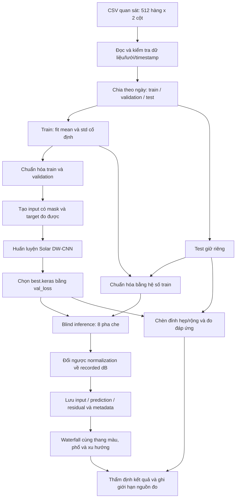
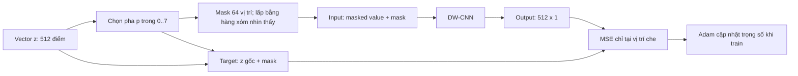
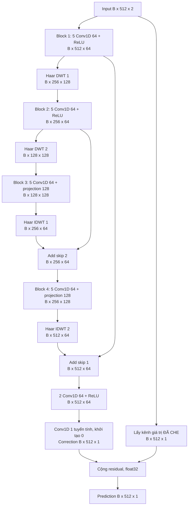
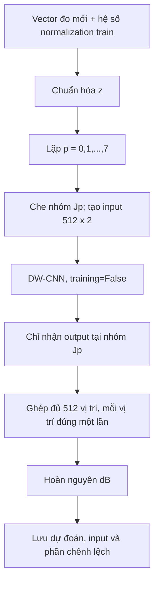

# Ý tưởng, bộ chỉ tiêu kỹ thuật và sơ đồ khối dự án Solar DW-CNN

**Ngày biên soạn:** 20/10/2026, giờ Việt Nam.  
**Phục vụ trình bày:** 21/10/2026.  
**Phạm vi:** mã nguồn trong `Solar_DW_CNN`, dữ liệu từ `Sun_Observering_Interferometry`.  
**Đối tượng đọc:** người mới học AI và xử lý tín hiệu.

> Tên đề tài đề xuất: **Nghiên cứu ứng dụng DW-CNN 1D với học tự giám sát để giảm nhiễu trên các vector đo trong quan sát vô tuyến Mặt Trời.**
>
> Chỉ dùng tên “khử nhiễu phổ vô tuyến Mặt Trời” như một kết luận về dữ liệu sau khi xác minh chuỗi thu thực sự có FFT. Hiện cột MHz chưa được xác nhận nguồn gốc.

## Mục lục

1. [Tóm tắt để nắm toàn bộ dự án](#1-tóm-tắt-để-nắm-toàn-bộ-dự-án)
2. [Dữ liệu thực tế và phạm vi bài toán](#2-dữ-liệu-thực-tế-và-phạm-vi-bài-toán)
3. [Ý tưởng và nguyên lý hoạt động](#3-ý-tưởng-và-nguyên-lý-hoạt-động)
4. [Bộ chỉ tiêu kỹ thuật](#4-bộ-chỉ-tiêu-kỹ-thuật)
5. [Sơ đồ khối và kiến trúc mạng](#5-sơ-đồ-khối-và-kiến-trúc-mạng)
6. [Quy trình triển khai và kiểm chứng](#6-quy-trình-triển-khai-và-kiểm-chứng)
7. [Kết quả hiện có và cách diễn giải](#7-kết-quả-hiện-có-và-cách-diễn-giải)
8. [Giới hạn, hướng phát triển và tài liệu đối chiếu](#8-giới-hạn-hướng-phát-triển-và-tài-liệu-đối-chiếu)

## 1. Tóm tắt để nắm toàn bộ dự án

### 1.1. Đang giải quyết việc gì?

Một hệ thống quan sát tạo ra nhiều file CSV theo thời gian. Mỗi file chứa 512 giá trị đo và một cột nhãn MHz. Khi ghép các vector liên tiếp thành ảnh, ta có một biểu diễn hai chiều tương tự waterfall: một chiều là chỉ số quan sát/thời gian, chiều còn lại là vị trí trong vector.

Mục tiêu nghiên cứu là dùng mạng DW-CNN học quan hệ giữa những vị trí lân cận để dự đoán giá trị đo ít chịu ảnh hưởng của thành phần không thể dự đoán từ ngữ cảnh. Đầu ra cần được kiểm tra đồng thời về mức giảm dao động và khả năng giữ các cấu trúc quan trọng.

**Mạng hiện tại xử lý từng vector 1D độc lập. Nó không nhận toàn bộ waterfall làm đầu vào và không học trực tiếp quan hệ giữa các thời điểm.**

### 1.2. Tại sao chuyển từ ECG sang dữ liệu này cần nhiều hơn thay đường dẫn?

Dự án ECG cũ có tín hiệu sạch và nhiễu để tạo cặp huấn luyện. Dữ liệu mới chưa có cặp như vậy. Ngoài ra, ECG là dạng sóng theo thời gian, còn dữ liệu mới là giá trị log được lưu theo một vector có nhãn tần số cần xác minh.

Vì vậy, dự án mới kế thừa **lõi kiến trúc** DW-CNN, nhưng thay cách đọc dữ liệu, chia tập, chuẩn hóa, tạo bài toán học, tính loss và đánh giá. Không lấy trọng số đã học từ ECG để coi là mô hình phù hợp sẵn với vô tuyến.

### 1.3. Sản phẩm đã có

| Sản phẩm | Vai trò |
|---|---|
| Bộ đọc CSV và audit | Kiểm tra dữ liệu đầu vào trước khi train |
| Bộ dữ liệu train/validation/test | Tách theo ngày quan sát để giảm nguy cơ rò rỉ dữ liệu |
| DW-CNN 1D đã điều chỉnh | Học dự đoán giá trị bị che từ ngữ cảnh |
| Pipeline huấn luyện GPU | Lưu checkpoint tốt nhất, ghi log, giảm learning rate và dừng sớm |
| Pipeline inference | Dự đoán đủ 512 vị trí bằng 8 pha che |
| Bộ xuất hình và số liệu | Giữ input, output, phần chênh lệch, biểu đồ và metadata |
| Phép thử chèn đỉnh | Kiểm tra mô hình có làm mất đặc trưng hẹp/rộng không |

### 1.4. Cách hiểu đúng về “spectrum đẹp”

Một ảnh ít hạt và tương phản cao có thể dễ nhìn, nhưng chưa chắc chính xác hơn. Trong dự án này, chất lượng cần được nhìn qua ba mặt:

1. **Dự đoán:** mô hình dự đoán điểm bị che tốt hơn một mốc đơn giản hay không?
2. **Giữ cấu trúc:** đỉnh, mức nền và biến thiên đáng quan tâm có bị thay đổi quá mức không?
3. **Nguồn đo:** trục tần số, đơn vị và chuỗi thu có đúng về vật lý không?

Chỉ mặt thứ nhất có thể đánh giá trực tiếp bằng masked loss hiện có. Mặt thứ hai cần thêm phép thử và thẩm định. Mặt thứ ba cần thông tin từ hệ thống thu.

## 2. Dữ liệu thực tế và phạm vi bài toán

### 2.1. Bốn thư mục liên quan

| Thư mục | Chức năng | Quan hệ với đề tài |
|---|---|---|
| `Dunglaibaibao` | Huấn luyện khử nhiễu ECG và so sánh nhiều mạng | Nguồn kiến trúc DW-CNN ban đầu |
| `esp32_deployment` | Triển khai mô hình ECG đã lượng tử hóa lên ESP32 | Không phải đích triển khai của dự án mới |
| `Sun_Observering_Interferometry` | Chứa mã thu, dữ liệu, notebook và hình quan sát | Nguồn dữ liệu mới |
| `Solar_DW_CNN` | Pipeline nghiên cứu độc lập cho dữ liệu mới | Phạm vi báo cáo này |

Tên dự án nguồn có “Interferometry” không đồng nghĩa CSV hiện có chứa đầy đủ dữ liệu giao thoa. CSV đang được dùng không có cặp I/Q hai anten hoặc visibility phức để đánh giá pha giao thoa.

### 2.2. Một mẫu dữ liệu là gì?

Một **frame** là một lần ghi vector vào một CSV. File không có header, có kích thước `(512, 2)`:

| Thành phần | Ý nghĩa |
|---|---|
| Cột 0 | Nhãn MHz do chương trình ghi dữ liệu tạo ra |
| Cột 1 | Giá trị log được ghi theo dB |
| 512 hàng | 512 vị trí của vector đo |
| Thời điểm | Được đọc từ tên file, quy ước UTC+07 trong loader |

Cột tần số không phải kênh tín hiệu thứ hai đưa vào CNN. Mạng hiện nhận hai kênh là **giá trị đã che** và **mask**.

**Chưa có:** nhãn tín hiệu sạch, nhãn RFI, I/Q gốc, pha, hiệu chuẩn dBm/SFU và xác nhận nguồn FFT cho từng phiên.

### 2.3. Thống kê dữ liệu

| Ngày | Số CSV | Nhãn MHz đầu–cuối | Vai trò mặc định |
|---|---:|---|---|
| 28/08/2024 | 2.500 | 621,4000–622,5977 | Không gộp vào run hiện tại |
| 11/10/2024 | 523 | 609,5000–610,4980 | Không gộp vào run hiện tại |
| 20/03/2025 | 1.433 | 608,8000–611,1953 | Train |
| 21/03/2025 | 1.433 | 608,8000–611,1953 | Train |
| 22/03/2025 | 1.433 | 608,8000–611,1953 | Train |
| 23/03/2025 | 1.434 | 608,8000–611,1953 | Validation |
| 24/03/2025 | 1.433 | 608,8000–611,1953 | Test |
| **Tổng** | **10.189** | Ba thiết lập lưới khác nhau | **7.166 CSV dùng mặc định** |

Train có 4.299 frame; validation có 1.434; test có 1.433. Tỷ lệ xấp xỉ 60%/20%/20% trong nhóm tháng 3/2025.

Hiệu hai nhãn đầu–cuối của nhóm tháng 3 là 2,3953 MHz. Nếu đây đúng là lưới FFT đều 512 điểm có điểm cuối loại trừ, độ rộng danh định tương ứng xấp xỉ 2,4 MHz, khoảng cách bin xấp xỉ 4,6875 kHz. **Đây là suy ra từ nhãn CSV có làm tròn, chưa phải xác nhận sample rate hay độ phân giải phổ thực của bộ thu.** Không nhầm khoảng cách bin với khả năng phân giải hai vạch khi có window.

### 2.4. Tại sao phải chia theo ngày?

Nếu chia ngẫu nhiên các frame liền nhau, một quan sát trong train có thể rất giống quan sát ngay bên cạnh trong validation/test. Khi đó điểm đánh giá dễ lạc quan hơn khả năng áp dụng sang một phiên mới.

Chia theo ngày giúp giảm vấn đề này. Tuy nhiên, chỉ có một ngày validation và một ngày test nên **chưa chứng minh khả năng tổng quát trên mọi ngày, thiết bị hoặc điều kiện thu**. Loader kiểm tra trùng byte CSV giữa các split, nhưng phép kiểm tra đó không phát hiện mọi bản sao gần giống hoặc mọi tương quan giữa các phiên.

### 2.5. Vấn đề FFT phải nêu rõ

Hai nhánh mã thu có cấu trúc khác nhau:

| Mã nguồn | Điều đã quan sát | Hệ quả |
|---|---|---|
| `Interferometer.py` / `interferometer.grc` | Đi từ vector I/Q sang bình phương biên độ mà không có FFT trong chuỗi đang thấy | Nếu CSV được tạo bằng nhánh này, nhãn MHz không đủ để biến các phần tử thành bin phổ |
| `dlite.grc` | Có FFT thuận, cửa sổ Blackman–Harris và dịch tâm | Có cấu trúc cần thiết để tạo phổ; vẫn phải xác minh đây là nhánh đã tạo CSV |

Bạn đã xác nhận hiện chưa rõ nguồn thu. Vì vậy báo cáo giữ trạng thái **“trục tần số chưa được xác minh”**.

Không thể lấy FFT của dãy dB trong CSV để khôi phục phổ I/Q đã mất pha. AI cũng không tự sửa được thiếu sót vật lý này từ các giá trị đã lưu.

## 3. Ý tưởng và nguyên lý hoạt động

### 3.1. Ý tưởng một câu

**Dùng DW-CNN học dự đoán các điểm đo bị che từ những điểm quan sát xung quanh, sau đó ghép các dự đoán để tạo một vector đầu ra và kiểm tra những gì đã bị thay đổi.**

### 3.2. Vì sao chọn học tự giám sát?

Học có giám sát cần đầu vào nhiễu và target sạch tương ứng. Bộ dữ liệu hiện chưa cung cấp target sạch. Nếu dùng chính vector nguyên vẹn làm cả input và target, mạng có thể học sao chép, không giải quyết được mục tiêu giảm nhiễu.

Cách che điểm tạo một nhiệm vụ khó hơn: mạng không nhìn thấy giá trị cần đoán. Nó phải tận dụng cấu trúc lân cận. Nếu tín hiệu có tương quan trong ngữ cảnh và thành phần nhiễu phù hợp giả thiết độc lập, việc dự đoán có thể giảm thành phần nhiễu khó đoán.

Đây là thiết kế lấy cảm hứng từ [Noise2Self — Batson và Royer, ICML 2019](https://proceedings.mlr.press/v97/batson19a.html). Nguồn này giải thích khả năng học từ dữ liệu nhiễu dưới giả thiết thống kê; không phải bằng chứng rằng tập quan sát hiện tại thỏa các giả thiết đó.

### 3.3. Mô hình toán đơn giản

Gọi `y[t,k]` là giá trị dB đo được ở frame `t`, vị trí `k`. Để mô tả mục tiêu học trong chính miền giá trị ghi nhận, có thể viết:

```text
y[t,k] = s_log[t,k] + epsilon[t,k]
```

Trong đó `s_log` là thành phần kỳ vọng cần dự đoán trong miền log, còn `epsilon` là phần sai khác của phép đo. Đây là **mô hình thống kê làm việc**, không phải khẳng định nhiễu vô tuyến vật lý cộng tuyến tính trong miền dB.

Để liên hệ chất lượng dự đoán với chất lượng khử nhiễu, cần giả thiết thích hợp về kỳ vọng của nhiễu, tính độc lập giữa các phần bị che/quan sát và khả năng dự đoán tín hiệu. RFI có tương quan, AGC và xử lý tích phân có thể vi phạm các giả thiết đó.

### 3.4. Chuẩn hóa trước khi che

Dùng hai scalar fit từ toàn bộ giá trị train:

```text
mu_train    = -32.055762918963666 dB
sigma_train =   0.023236983701811202 dB
z[t,k] = (y[t,k] - mu_train) / sigma_train
```

Các hệ số trên thuộc đúng bộ dữ liệu đã chuẩn bị hiện tại, không phải hằng số dùng cho mọi bộ thu.

Giải thích: mạng làm việc với số có độ lớn phù hợp hơn, nhưng vẫn có thể hoàn nguyên về giá trị dB bằng:

```text
y_hat[t,k] = z_hat[t,k] * sigma_train + mu_train
```

Validation/test dùng nguyên hai hệ số train. Không fit thêm theo test và không lấy mean/std riêng của từng frame trước khi che. Cách chuẩn hóa từng frame vừa có thể làm mất biến thiên mức nền, vừa có thể đưa thông tin của giá trị cần che vào thống kê đầu vào.

“Hoàn nguyên đơn vị” chỉ có nghĩa đổi ngược phép chuẩn hóa; không có nghĩa mạng đã bảo toàn đúng tín hiệu vật lý.

### 3.5. Cách tạo mask — giải thích từng bước

Chọn một pha `p` từ 0 đến 7. Đặt:

```text
M[k] = 1 nếu k mod 8 = p; ngược lại M[k] = 0
```

Có đúng **64 vị trí bị che trong vector 512 điểm**. Với pha 0, các vị trí là `0, 8, 16, ..., 504`.

Ở vị trí bên trong vector, thay giá trị bị che bằng trung bình hai hàng xóm không bị che. Ở đầu/cuối vector, dùng hàng xóm phía trong, không nối vòng từ cuối về đầu.

Ví dụ một đỉnh có giá trị đo là 10 ở vị trí 8, còn vị trí 7 và 9 đều bằng 2. Nếu vị trí 8 bị che thì input tại đó là 2, không phải 10. Target vẫn là giá trị đo 10. Mạng không thể sao chép 10 từ chính vị trí ấy.

**Ví dụ này cũng chỉ ra giới hạn:** nếu đỉnh 10 là một vạch thật chỉ tồn tại tại đúng một vị trí, ngữ cảnh có thể không đủ để khôi phục. Nếu đó là RFI thì việc giảm đỉnh có thể hữu ích. Không có nhãn thì không thể mặc nhiên biết trường hợp nào đang xảy ra.

### 3.6. Input, target và output

| Tensor | Kích thước mỗi frame | Nội dung |
|---|---|---|
| Input mạng | `(512, 2)` | Kênh 0: giá trị đã che; kênh 1: mask 0/1 |
| Target truyền cho loss | `(512, 2)` | Kênh 0: giá trị đo chuẩn hóa ban đầu; kênh 1: mask |
| Output mạng | `(512, 1)` | Giá trị dự đoán ở từng vị trí |

`B` trong `(B, 512, 2)` là số frame trong một batch. Với batch 16, mạng xử lý 16 vector cùng lúc, không ghép chúng thành một chuỗi dài.

### 3.7. Hàm mất mát

Với frame `t`:

```text
L_t = sum_k [M[t,k] * (z_hat[t,k] - z[t,k])²] / sum_k M[t,k]
L_batch = trung bình L_t trong batch
```

Chỉ vị trí bị che góp vào loss. Target là **giá trị đo**, không gọi là “sạch”. Validation giữ mask cố định; train thay mask giữa các epoch.

Không thêm loss FFT lên toàn bộ output hiện tại vì phần output ở vị trí không bị che không được ràng buộc như một phép dự đoán mù hoàn chỉnh trong lượt đó; hơn nữa dữ liệu đã là miền log và nguồn trục tần số còn chưa xác nhận.

### 3.8. Haar DWT/IDWT làm gì?

Với hai giá trị liên tiếp `a`, `b` trong mỗi kênh đặc trưng:

```text
L = (a + b) / sqrt(2)
H = (a - b) / sqrt(2)
a = (L + H) / sqrt(2)
b = (L - H) / sqrt(2)
```

`L` biểu diễn thành phần tổng hợp ở quy mô lớn hơn; `H` biểu diễn chênh lệch cục bộ. DWT giảm một nửa chiều dài và tăng gấp đôi số kênh. IDWT làm ngược lại.

Trong số học lý tưởng, cặp Haar thuận/nghịch có thể tái tạo và bảo toàn tổng bình phương cho chính phép biến đổi đó. **Toàn bộ mạng có Conv/ReLU và học trọng số không vì vậy mà bảo toàn năng lượng.**

`H` cũng không mặc nhiên là RFI: một đỉnh phát xạ thật có thể tạo detail lớn. Các kênh này là đặc trưng trên trục vector, không phải trực tiếp chia sóng điện từ 610 MHz thành phần “tín hiệu thật” và “nhiễu”.

### 3.9. Skip connection và residual head

Hai skip cộng đặc trưng encoder sang decoder giúp đường truyền thông tin/gradient ngắn hơn. Chúng hỗ trợ học, nhưng không bảo đảm đỉnh hay diện tích được giữ nguyên.

Head dự đoán phần hiệu chỉnh và cộng vào **giá trị đầu vào đã che**:

```text
output = masked_value + learned_correction
```

Conv cuối khởi tạo bằng 0 nên lúc đầu output bằng giá trị lấp hàng xóm. Không có nhánh tắt mang giá trị gốc chưa che vào output tại vị trí cần đoán.

### 3.10. Tại sao inference cần 8 pha?

Mỗi pha chỉ có 64 vị trí là dự đoán mù hợp lệ. Vì vậy, chạy đủ 8 pha và mỗi lượt chỉ lấy output ở vị trí đang che. Hợp của tám nhóm chứa đủ 512 vị trí, mỗi vị trí được lấy đúng một lần.

Đầu ra không phải trung bình tùy ý của tám vector. Chạy một lần với mask toàn 0 sẽ khác cách huấn luyện và không phải quy trình inference hiện tại.

## 4. Bộ chỉ tiêu kỹ thuật

### 4.1. Cách phân loại chỉ tiêu

- **Đã triển khai/đã quan sát:** có mã nguồn, dữ liệu hoặc log chứng minh.
- **Chỉ tiêu kiểm tra đề xuất:** dùng để tổ chức đánh giá tiếp theo, chưa phải thành tích đạt được hay tiêu chuẩn ngành.
- **Chưa đo/chưa đủ dữ liệu:** phải để trống hoặc ghi đúng trạng thái; không tự điền số kỳ vọng thành kết quả.

### 4.2. Thông số đầu vào và quản lý dữ liệu

| Mã | Chỉ tiêu | Giá trị/yêu cầu trong dự án | Trạng thái và bằng chứng |
|---|---|---|---|
| D01 | Định dạng nguồn | CSV không header, 512 hàng × 2 cột cho bộ hiện tại | Đã audit; `dataset_audit.json` |
| D02 | Giá trị hữu hạn | Không chấp nhận NaN/Inf | Loader có kiểm tra |
| D03 | Lưới trong một ngày | Cùng shape, tăng nghiêm ngặt, so sánh `atol=1e-6`, `rtol=0` | `data.py`; tolerance để đối chiếu nhãn MHz, không phải độ chính xác thiết bị |
| D04 | Lưới giữa các ngày trong run | Phải khớp cùng điều kiện D03 | Loader từ chối lưới khác |
| D05 | Chia tập | 4.299/1.434/1.433, theo ngày không trùng | Metadata đã lưu |
| D06 | Chuẩn hóa | Hai scalar mean/std từ train | Không fit trên validation/test |
| D07 | Dữ liệu gốc | Chỉ đọc; output ghi thư mục riêng | Đã triển khai |
| D08 | Truy xuất nguồn | Tên file, timestamp, SHA256 CSV, cấu hình | Đã triển khai; SHA256 kiểm tra nội dung byte, không chứng minh nguồn thu đúng |
| D09 | Đơn vị vật lý | Chỉ ghi “recorded dB” | Chưa hiệu chuẩn dBm/SFU |
| D10 | Nguồn FFT | Phải xác nhận flowgraph tạo từng phiên | **Chưa xác minh** |

### 4.3. Thông số mô hình

| Mã | Chỉ tiêu | Cấu hình mặc định |
|---|---|---|
| M01 | Kiến trúc | DW-CNN 1D encoder–decoder, hai cấp Haar |
| M02 | Input / output | `(B,512,2)` / `(B,512,1)` |
| M03 | Kênh input | Giá trị đã che + mask |
| M04 | Filters cơ sở | 64; projection ở bottleneck/decoder là 128 |
| M05 | Kernel Conv1D | 3, stride 1, padding `same` |
| M06 | Số Conv1D | 25, tính cả projection và head |
| M07 | Phi tuyến | ReLU ở conv đặc trưng; correction cuối tuyến tính |
| M08 | Skip | Hai nhánh cộng encoder–decoder; một nhánh residual giá trị đã che |
| M09 | Tham số trainable | **334.017** ở `filters=64` |
| M10 | Tham số wavelet | Không có trọng số học trong HaarDWT/HaarIDWT |
| M11 | Điều kiện chiều dài chung | Ít nhất 16 và chia hết cho 4; bộ hiện tại dùng 512 |
| M12 | Phạm vi ngữ cảnh | Bên trong từng vector; không có nhánh học theo thời gian giữa frame |

25 lớp Conv không có nghĩa 25 cấp wavelet. Mạng có đúng hai lần DWT và hai lần IDWT.

### 4.4. Thông số huấn luyện và vận hành GPU

| Mã | Chỉ tiêu | Cấu hình | Cách hiểu |
|---|---|---|---|
| T01 | Kiểu học | Masked self-supervision | Không cần nhãn clean hiện chưa có |
| T02 | Mask period | 8 | 64/512 vị trí mỗi frame |
| T03 | Loss | Masked MSE | Trên giá trị chuẩn hóa, chỉ điểm che |
| T04 | Optimizer | Adam | Học trọng số Conv1D |
| T05 | Learning rate ban đầu | `1e-4` | Có thể giảm trong quá trình học |
| T06 | Gradient clipping | `clipnorm=1.0` | Hạn chế norm gradient theo cơ chế optimizer |
| T07 | Batch size | 16 | Giảm còn 8/4 nếu OOM |
| T08 | Số epoch tối đa | 100 | Có thể dừng trước do early stopping |
| T09 | Early stopping | `val_loss`, patience 15 | Dừng khi không cải thiện theo quy tắc callback |
| T10 | Giảm learning rate | Hệ số 0,5; patience 5 ở cấu hình hiện tại; sàn `1e-7` | `ReduceLROnPlateau` |
| T11 | Chọn checkpoint | `val_loss` nhỏ nhất | Không chọn bằng test |
| T12 | Seed | 42 | Hỗ trợ lặp lại, không bảo đảm mọi phép GPU tái lập bit tuyệt đối |
| T13 | Framework đã chạy | TensorFlow 2.15.1, Python 3.11 trong môi trường `anh` | Môi trường cài mới chưa được kiểm định riêng |
| T14 | GPU đã chạy | NVIDIA RTX A2000 Laptop, 4 GB VRAM | Không phải mức RAM peak đã đo của mô hình |
| T15 | Precision | `mixed_float16`; correction/head/loss float32 | Wavelet cũng chịu compute policy; không tuyên bố toàn bộ mạng float32 |
| T16 | Quản lý GPU | Memory growth; báo lỗi nếu không thấy GPU | CPU cần bật `--allow-cpu` rõ ràng |
| T17 | Checkpoint | `best.keras`, custom layer/loss có đăng ký | Lưu/nạp đã được thử |
| T18 | Log | `config.json`, `history.csv`, TensorBoard, báo cáo khi train kết thúc | Có thể chưa có báo cáo cuối khi run còn chạy hoặc bị ngắt |

Ở cấu hình đầy đủ:

```text
Train: ceil(4299 / 16) = 269 batch / epoch
Validation: ceil(1434 / 16) = 90 batch / epoch
Test: ceil(1433 / 16) × 8 pha = 720 lượt forward theo batch
```

Lượt forward theo batch không phải số mẫu/giây. Chưa có benchmark chuẩn cho latency, throughput hoặc độ trễ thu–xử lý–hiển thị; **chưa kết luận realtime**.

### 4.5. Bộ chỉ tiêu đánh giá hiện có

Quy ước `y` là input dB; `y_hat` là dự đoán dB; `r = y - y_hat`; `N` là số frame, `K=512`.

| Mã | Chỉ tiêu và công thức | Đơn vị | Diễn giải đúng | Đã có ở đâu? |
|---|---|---|---|---|
| Q01 | Validation masked MSE: công thức mục 3.7 | Không thứ nguyên | Khả năng dự đoán giá trị đo bị che | `history.csv`, `training_report.json` khi xong |
| Q02 | Mốc nội suy: cùng mask, output bằng giá trị lấp hàng xóm | Không thứ nguyên | Mốc kiểm tra mạng có học thêm được từ ngữ cảnh | `validation_baseline.json` |
| Q03 | Giảm MSE tương đối: `100 × (1 - L_model/L_neighbor)` | % | Cải thiện Q01 so với Q02; không phải % loại RFI | Tính từ log và baseline; snapshot báo cáo có lưu |
| Q04 | RMS thay đổi: `sqrt(mean(r²))` | dB | Độ lớn thay đổi giữa input/output | `infer.py` → `rms_change_db` |
| Q05 | Dịch mức trung bình: `mean(y_hat-y)` | dB | Output tăng/giảm mức log trung bình thế nào | `mean_shift_db` |
| Q06 | Trung bình trị tuyệt đối dịch mean từng frame: `mean_t(abs(mean_k(r[t,k])))` | dB | Tránh dịch tăng/giảm giữa frame triệt tiêu lẫn nhau | `mean_abs_frame_mean_shift_db` |
| Q07 | Thay đổi cực đại: `max(abs(r))` | dB | Tìm vị trí bị tác động mạnh để xem xét | `max_abs_change_db` |
| Q08 | Full blind prediction MSE: `mean((r/sigma_train)²)` | Không thứ nguyên | Sai khác với giá trị đo khi mọi điểm được dự đoán qua đủ 8 pha | `masked_prediction_mse_normalized` trong inference |
| Q09 | Kiểm tra residual bằng mắt | Định tính | Tìm cấu trúc đáng quan tâm bị đưa vào phần chênh lệch | Waterfall/residual |
| Q10 | Cùng thang hiển thị | Percentile input 1–99% áp dụng cho cả input/output | Tránh tạo cảm giác cải thiện do đổi contrast riêng | `infer.py`; NPZ không clip theo percentile |

**Q04 lớn không chứng minh loại nhiều nhiễu; Q04 nhỏ không chứng minh lọc tốt.** Cả hai đều cần được đọc cùng mức giữ cấu trúc và thông tin về nguồn đo.

Q01 thường đánh giá một pha cố định mỗi frame validation, còn Q08 đánh giá đủ mọi bin và có thể trên ngày test. Không yêu cầu hai con số bằng nhau và không so trực tiếp chúng như cùng một tập phép đo.

### 4.6. Chỉ tiêu giữ đặc trưng bằng phép thử chèn đỉnh

`diagnose.py` lấy vector chuẩn hóa `z`, tạo đỉnh Gaussian `g` và đo:

```text
g[k] = exp(-0.5 * ((k - k0) / sigma_bins)²)
response[k] = F(z + g)[k] - F(z)[k]
R_peak = response[k0] / g[k0]             # g[k0] = 1
R_sum  = sum_k response[k] / sum_k g[k]
E_response = sqrt(mean((response - g)²))
```

`F` là toàn bộ blind inference 8 pha. Tâm `k0` được chọn bên trong vector, thay đổi giữa các frame lấy mẫu. Biên độ chèn là một training std, tương ứng khoảng **0,023237 dB** trong miền ghi nhận hiện tại.

| Mã | Chỉ tiêu | Cách diễn giải |
|---|---|---|
| P01 | `R_peak` | Gần 1: giữ độ cao đỉnh chèn; gần 0: đỉnh bị triệt; >1: có thể khuếch đại |
| P02 | `R_sum` | Kiểm tra tổng đáp ứng theo chỉ số bin; không phải năng lượng/flux vật lý |
| P03 | `E_response` | Độ lệch toàn hình đáp ứng so với đỉnh đã chèn |
| P04 | Nhiều độ rộng | `sigma_bins = 0.5, 1, 2, 4, 8, 16`; đây là sigma, không phải FWHM |
| P05 | Số frame | CLI mặc định 16; phép thử smoke lưu sẵn dùng 4 frame |

Đỉnh thêm trực tiếp vào log không phải phép cộng một nguồn phát công suất tuyến tính. Đây là phép thử độ nhạy của thuật toán. Đổi sang phép chèn tín hiệu vật lý cần mô hình nguồn thu/hiệu chuẩn phù hợp.

`R_sum` gần 1 vẫn có thể đi kèm đỉnh thấp và bị bè rộng. Vì thế phải đọc P01, P02 và hình đáp ứng cùng nhau.

### 4.7. Điều kiện nghiệm thu đề xuất theo giai đoạn

| Giai đoạn | Điều kiện đề xuất | Hiện trạng |
|---|---|---|
| G1 — Pipeline chạy đúng | Dữ liệu qua kiểm tra; không trùng split; loss hữu hạn; lưu/nạp được; output hữu hạn đủ kích thước; kiểm thử qua | Có bằng chứng kỹ thuật hiện tại |
| G2 — Có học được | Trên cùng validation cố định, masked MSE thấp hơn mốc nội suy; train đủ và lưu báo cáo kết thúc | Snapshot hiện thấp hơn mốc; chưa có báo cáo kết thúc tại thời điểm chụp |
| G3 — Dùng cho cấu trúc quan tâm | Xác định trước độ rộng/biên độ đặc trưng cần giữ, đo peak và hình đáp ứng; thẩm định residual | Công cụ có; chưa xác lập ngưỡng khoa học được chấp thuận |
| G4 — Kết luận về phổ/RFI | Xác minh FFT, hiệu chuẩn, nhãn hoặc dữ liệu tham chiếu độc lập phù hợp | Chưa đủ |
| G5 — Vận hành theo thời gian thực | Đo latency, throughput, peak VRAM, tốc độ frame nguồn và tỷ lệ lỗi end-to-end | Chưa benchmark |

Một ví dụ để **thảo luận mục tiêu G3**, không phải tiêu chuẩn đã được xác nhận: nếu ứng dụng chỉ quan tâm đỉnh đủ rộng `sigma >= 4 bin`, có thể đề xuất kiểm tra `0,9 <= R_peak <= 1,1` trong một dải biên độ và nhiều ngày độc lập. Chưa được dùng ví dụ này để tuyên bố mô hình đạt chuẩn; cần thống nhất mục tiêu với người phụ trách khoa học và đo lại checkpoint cuối.

Không đề ra SNR tăng bao nhiêu dB khi không có reference để đo. Không lấy thông số mong muốn trên giấy làm kết quả thực nghiệm.

### 4.8. Những chỉ tiêu chỉ đo được khi bổ sung dữ liệu

| Chỉ tiêu tương lai | Dữ liệu/điều kiện cần thêm |
|---|---|
| RMSE/MAE với tín hiệu sạch | Target sạch đáng tin cậy, căn chỉnh đúng frame/lưới |
| SNR và SNR improvement | Định nghĩa tín hiệu/nhiễu cùng miền tính, reference phù hợp; không dùng trực tiếp nền dB âm làm “công suất tín hiệu” |
| Precision/Recall/F1 nhận diện RFI | RFI mask có nhãn và một quy tắc tạo quyết định phát hiện; mạng hiện không có head phân loại |
| Sai số thông lượng/diện tích công suất | Phổ tuyến tính được hiệu chuẩn, bandwidth/window normalization và reference |
| Độ trễ/độ rộng/thời điểm burst | Nhãn sự kiện và độ phân giải thời gian được xác minh |
| Pha/coherence/visibility | Dữ liệu hai anten đồng bộ, phức, kèm hiệu chuẩn |
| Khoảng tin cậy thống kê | Nhiều phiên độc lập; thiết kế đánh giá tính đến tương quan, không coi mọi bin là mẫu độc lập |

## 5. Sơ đồ khối và kiến trúc mạng

Các sơ đồ Mermaid dưới đây có thể xem trong trình Markdown hỗ trợ Mermaid. Mục 5.6 có bản chữ để dùng khi trình chiếu không hỗ trợ.

### 5.1. Sơ đồ hệ thống tổng thể đang triển khai



**Cách thuyết trình:** “Em kiểm tra và chia dữ liệu trước, chỉ học normalization từ train. Validation chọn mô hình; test giữ riêng cho đánh giá. Đầu ra được lưu cả phần dự đoán và phần thay đổi để tránh chỉ nhìn ảnh đẹp.”

### 5.2. Sơ đồ một lượt huấn luyện



Validation dùng cùng đường tính input/output/loss, nhưng không cập nhật trọng số. Pha validation cố định để có mốc so sánh qua epoch.

### 5.3. Sơ đồ kiến trúc DW-CNN đúng theo mã nguồn



Mũi tên skip đi vào phép **cộng**, không phải concatenate. DWT concatenate hai nhóm hệ số L/H theo kênh; đó là phép nối bên trong wavelet, khác skip.

### 5.4. Bảng shape và số tham số để kiểm tra sơ đồ

Với Conv1D có bias: `params = kernel_size × C_in × C_out + C_out`.

| Khối | Input mỗi frame | Output mỗi frame | Conv1D | Params |
|---|---|---|---:|---:|
| Block 1 | `512×2` | `512×64` | 5 | 49.856 |
| DWT 1 | `512×64` | `256×128` | 0 | 0 |
| Block 2 | `256×128` | `256×64` | 5 | 74.048 |
| DWT 2 | `256×64` | `128×128` | 0 | 0 |
| Block 3 | `128×128` | `128×128` | 6 | 98.752 |
| IDWT 1 + Add | `128×128` và skip `256×64` | `256×64` | 0 | 0 |
| Block 4 | `256×64` | `256×128` | 6 | 86.464 |
| IDWT 2 + Add | `256×128` và skip `512×64` | `512×64` | 0 | 0 |
| Head: 2 conv 64 + correction 1 | `512×64` | `512×1` | 3 | 24.897 |
| ValueChannel + residual Add | Giá trị đã che và correction | `512×1` | 0 | 0 |
| **Tổng** | | | **25** | **334.017** |

Ví dụ Conv đầu: `3×2×64+64 = 448` tham số. Việc chiều dài giảm không tự giảm số tham số Conv; tham số phụ thuộc kernel và số kênh. Shape đúng ở hai nhánh Add là điều kiện bắt buộc để cộng được.

### 5.5. Sơ đồ inference và lắp vector đầu ra



Nhóm `Jp = {k | k mod 8 = p}`. Các nhóm không giao nhau và hợp lại chứa đủ vector. Không lấy kết quả tại những vị trí đang không che trong lượt đó để làm đầu ra cuối.

### 5.6. Bản sơ đồ chữ để đưa vào slide nhanh

```text
CSV quan sát
    │
    ▼
Kiểm tra → chia theo ngày → fit normalization từ TRAIN
    │
    ▼
Che 64/512 vị trí → [giá trị đã che, mask]
    │
    ▼
Conv block 1 ─────────────────────────────────── skip 1 ──┐
    │ Haar DWT                                          │
Conv block 2 ────────────────── skip 2 ──┐                │
    │ Haar DWT                          │                │
Bottleneck                              │                │
    │ Haar IDWT                         │                │
    └─────────────────────────────── Add                 │
                                        │                │
                                  Conv block 4           │
                                        │ Haar IDWT      │
                                        └────────────── Add
                                                         │
                                                Head + residual
                                                         │
                   Train: masked MSE ◄────────────────────┤
                                                         │
                   Inference: ghép 8 pha → hoàn nguyên dB
                                                         │
                              NPZ + waterfall + residual + feature probe
```

### 5.7. Sơ đồ chuỗi thu cần xác minh — ngoài pipeline AI

```text
Nhánh Interferometer đang thấy:
I/Q → chia vector → |x|² → trung bình → log10 → tích phân → CSV
                   ↑ Không có FFT trước bước này trong nhánh đã đọc.

Chuỗi tham chiếu để thiết kế thu phổ:
I/Q → chia vector → window → FFT → fftshift → |FFT|²
    → tích phân công suất tuyến tính → chuẩn hóa/hiệu chuẩn phù hợp
    → log cho hiển thị + lưu metadata đầy đủ
```

Sơ đồ thứ hai là hướng thiết kế cần kiểm định khi thu lại, không phải tuyên bố dự án đã sửa hệ thống thu. Hai anten giao thoa còn cần đồng bộ và xử lý cross-correlation/visibility tương ứng; chỉ thêm FFT cho một nhánh không hoàn thành một hệ giao thoa.

## 6. Quy trình triển khai và kiểm chứng

### 6.1. Trình tự thực hiện cho người mới

| Bước | Làm gì? | Vì sao? | Đầu ra cần nhìn |
|---|---|---|---|
| 1 | Đọc README, flowgraph và khối ghi CSV | Biết một con số đại diện cho gì | Xác định đơn vị, chiều dữ liệu, điểm chưa chắc chắn |
| 2 | Audit toàn bộ CSV | Tránh train trên file lỗi hoặc lưới lẫn nhau | `dataset_audit.json` |
| 3 | Chia theo ngày | Hạn chế đánh giá quá lạc quan do frame gần nhau | `train.npz`, `val.npz`, `test.npz` |
| 4 | Fit normalization từ train | Tránh rò thông tin test và thống nhất thang số | Mean/std trong metadata |
| 5 | Tạo bài toán che điểm | Có mục tiêu học khi chưa có clean | Input/target đúng shape, mask đúng 64 điểm |
| 6 | Kiểm thử mô hình và masking | Bảo đảm chương trình thực hiện đúng thiết kế | Log kiểm thử và checkpoint thử |
| 7 | Train đầy đủ trên GPU | Học trọng số từ train và chọn bằng validation | `history.csv`, `best.keras` |
| 8 | Xác nhận run kết thúc hợp lệ | Tránh trình bày checkpoint đang thay đổi như kết quả cuối | `training_report.json`, kiểm tra log lỗi |
| 9 | Inference và feature probe | Đánh giá đầu ra và rủi ro mất đặc trưng | Report, NPZ, waterfall, đồ thị đáp ứng |
| 10 | Thẩm định nguồn thu và chất lượng khoa học | Kết nối độ đúng phần mềm với độ đúng đo lường | Kết luận có phạm vi, kế hoạch bổ sung dữ liệu |

Dữ liệu đã được chuẩn bị; không cần chạy lại bước 3 chỉ để làm báo cáo. Thao tác đọc log không làm gián đoạn hoặc khởi động lại run đang train.

### 6.2. Kiểm thử đã có

| Nhóm kiểm tra | Nội dung | Kết luận được phép rút ra |
|---|---|---|
| Mask | Đổi mạnh giá trị bị che mà input không đổi, kể cả ở biên | Target không rò qua cơ chế lấp điểm |
| Normalization/split | Thay test không đổi thống kê train; từ chối ngày/lưới sai | Logic chia dữ liệu và fit thống kê hoạt động theo thiết kế |
| Haar | Tái tạo thuận/nghịch, kiểm tra tổng bình phương và gradient | Phép biến đổi được kiểm tra số học ở cấu hình test float32 |
| Loss | Sai số tại vị trí không che không góp vào loss | Loss thực hiện đúng mask |
| Serialization/inference | Train một batch nhỏ, lưu/nạp, so output và tính độc lập với điểm bị che | Custom layer/loss và blind inference chạy được |

Tổng **5 test methods đã qua** trong `test_results.log`. Việc kiểm thử phần mềm qua không xác nhận toàn bộ giả thiết thống kê hay độ đúng khoa học.

### 6.3. Lệnh kiểm tra trước báo cáo

Chạy từ `Solar_DW_CNN`, dùng môi trường `anh` đã hoạt động:

```bash
cd /home/vietanh/Downloads/ECG/Solar_DW_CNN
conda activate anh

# Đọc cấu hình và tiến độ; không khởi động train lại.
cat runs/solar_v1/history.csv
cat runs/solar_v1/validation_baseline.json

# Khi run kết thúc bình thường, đọc thêm file này nếu đã được tạo.
cat runs/solar_v1/training_report.json
```

Nếu chưa có `training_report.json`, kiểm tra log và tiến trình. Thiếu file có thể do đang chạy hoặc bị ngắt/lỗi; riêng sự thiếu file không đủ phân biệt hai trường hợp.

Lệnh dưới đây dành cho **sau khi chốt checkpoint để báo cáo**. Chọn output mới để không ghi đè:

```bash
CUDA_VISIBLE_DEVICES=0 python -m solar_dwcnn.infer \
  --run runs/solar_v1 --data data/prepared --split test \
  --output outputs/solar_v1_report_test --batch-size 16

CUDA_VISIBLE_DEVICES=0 python -m solar_dwcnn.diagnose \
  --run runs/solar_v1 --data data/prepared \
  --output outputs/solar_v1_report_probe --samples 16
```

Không gọi ảnh từ `outputs/gpu_smoke_test` là kết quả của `solar_v1`. Hai thư mục dùng checkpoint khác nhau.

### 6.4. Nếu bắt đầu một thí nghiệm mới

`solar_v1` đã tồn tại, nên một lần train mới phải dùng tên chưa tồn tại, chẳng hạn:

```bash
CUDA_VISIBLE_DEVICES=0 python -m solar_dwcnn.train \
  --run runs/solar_v2 --epochs 100 --batch-size 16 \
  --learning-rate 0.0001 --mixed-precision
```

Không cần chạy lệnh này để hoàn thiện bài trình bày nếu run hiện tại đang hoạt động. Hệ thống hiện không cung cấp CLI resume tự động; checkpoint tốt nhất không đồng nghĩa có một quy trình tiếp tục chính xác toàn bộ trạng thái callback/epoch.

## 7. Kết quả hiện có và cách diễn giải

### 7.1. Phân biệt ba nhóm bằng chứng

| Nhóm | Mục đích | Được dùng để kết luận gì? |
|---|---|---|
| `gpu_smoke`, `gpu_verified` | Chạy rất ngắn để kiểm tra kỹ thuật | Pipeline train/lưu/nạp/infer hoạt động |
| `solar_v1` | Run huấn luyện đầy đủ, không giới hạn train/validation steps | Theo dõi học và chọn checkpoint bằng validation |
| Feature probe lưu sẵn | Đo đáp ứng của **checkpoint gpu_verified** trên 4 frame | Chỉ ra rủi ro mất đỉnh hẹp của checkpoint thử |

`VERIFICATION.md` ghi giai đoạn kiểm tra trước đó. Tài liệu này bổ sung snapshot `solar_v1` có sau, không sửa lịch sử kiểm tra cũ.

### 7.2. Snapshot huấn luyện để đưa vào slide

**Chụp lúc 10:15:27 ngày 20/10/2026, UTC+07.** Lưu tại [training_snapshot.json](training_snapshot.json) và [solar_v1_history_snapshot.csv](solar_v1_history_snapshot.csv). Đây là mốc cố định; log trực tiếp có thể đã thay đổi sau đó.

| Nội dung | Số liệu từ snapshot |
|---|---:|
| Số epoch đã có trong CSV tại lúc chụp | 29 |
| Epoch có validation tốt nhất đã ghi nhận | Epoch 28 theo cách đếm từ 1; CSV ghi `epoch=27` |
| Best validation masked MSE đã ghi nhận | 0,9295660853 |
| Mốc nội suy trên validation mask | 1,2697349306 |
| Mức giảm masked MSE tương đối | 26,79054% |
| `training_report.json` tại lúc chụp | Chưa có |
| Run có cắt bớt steps không? | Không; `steps_per_epoch=None`, `validation_steps=None` |

Phép tính:

```text
100 × (1 - 0.9295660853 / 1.2697349306) ≈ 26.79%
```

**Câu được phép nói:** “Ở snapshot hiện tại, mô hình dự đoán điểm đo bị che tốt hơn mốc nội suy, với masked MSE validation giảm khoảng 26,79%.”

**Không chuyển thành:** “Đã loại 26,79% RFI”, “SNR tăng 26,79%”, “đã giữ 100% năng lượng” hoặc “đã hoàn tất 100 epoch”. Số liệu snapshot không chứng minh các phát biểu đó.

Sự cải thiện chỉ cho thấy chất lượng dự đoán theo phép đo self-supervised hiện có. Đánh giá khoa học còn phụ thuộc giả thiết nhiễu và tín hiệu, nguồn thu và kiểm định độc lập.

### 7.3. Kết quả feature probe của checkpoint chạy thử

Nguồn: `outputs/gpu_verified_probe/injection_response.json`. Biên độ chèn khoảng 0,023237 dB, 4 frame ở chỉ số `0, 477, 954, 1432`. Bảng là median tỷ lệ đáp ứng giữa các frame đó.

| Sigma đỉnh chèn, bin | Tỷ lệ giữ độ cao đỉnh `R_peak` | Tỷ lệ tổng đáp ứng `R_sum` | Diễn giải |
|---:|---:|---:|---|
| 0,5 | 0,1353 | 0,9998 | Đỉnh rất hẹp suy giảm mạnh |
| 1 | 0,6064 | 0,9997 | Đỉnh hẹp còn suy giảm đáng kể |
| 2 | 0,8822 | 0,9997 | Đỉnh rộng hơn được giữ tốt hơn về độ cao |
| 4 | 0,9689 | 0,9997 | Đáp ứng gần đỉnh chèn trong phép thử này |
| 8 | 0,9918 | 0,9997 | Đỉnh rộng gần giữ nguyên độ cao trong phép thử |
| 16 | 0,9977 | 0,9997 | Tương tự, với đỉnh rất rộng |

Đây là checkpoint gần khởi tạo: correction ban đầu nhỏ, đầu ra gần phép lấp bằng hàng xóm. Với một đỉnh Gaussian đơn lẻ và bộ lấp này, đáp ứng tại tâm xấp xỉ `exp(-1/(2*sigma²))`, giải thích xu hướng suy giảm đỉnh hẹp. Mạng train lâu hơn có thể thay đổi đáp ứng, nhưng phải đo lại để biết, không suy đoán thành kết quả.

Bảng cho thấy rõ: tổng đáp ứng gần 1 không bảo đảm đỉnh cao được giữ. Đỉnh có thể bè sang vị trí xung quanh. **Không gọi `R_sum` là tỷ lệ giữ năng lượng Mặt Trời.**

### 7.4. Những số liệu chưa được kết luận

- Chưa có báo cáo test cuối cho `solar_v1` trong bộ bằng chứng đã chụp.
- Chưa có feature probe của checkpoint cuối `solar_v1` trong bộ bằng chứng này.
- Chưa có SNR/PSNR với target sạch, độ chính xác phân loại RFI hoặc sai số flux.
- Chưa benchmark realtime, latency, throughput hoặc peak VRAM.
- Chưa xác nhận dữ liệu được thu bằng flowgraph có FFT.

Không tự lấp các mục này bằng kết quả của run khác hoặc bằng giá trị mong muốn.

## 8. Giới hạn, hướng phát triển và tài liệu đối chiếu

### 8.1. Rủi ro và cách xử lý tiếp

| Rủi ro | Biểu hiện | Bước tiếp theo |
|---|---|---|
| Trục MHz không đúng nguồn dữ liệu | Phổ hiển thị không đại diện phổ vật lý | Xác minh flowgraph, metadata hoặc thu lại I/Q |
| Nhiễu tương quan | Mạng học giữ cả nhiễu có cấu trúc | Đánh giá theo nhiều lag/phiên, bổ sung reference và nhãn RFI |
| Mất vạch phát xạ thật | Đỉnh hẹp thấp đi, xuất hiện trong residual | Probe đúng dải độ rộng/biên độ quan tâm, thẩm định khoa học |
| Đánh giá quá lạc quan | Validation tốt nhưng ngày mới kém | Thêm nhiều ngày độc lập, giữ test mới để đánh giá cuối |
| Chỉ tối ưu ảnh hiển thị | Ảnh đẹp nhưng số liệu méo | Giữ dữ liệu gốc; dùng cùng thang màu; đo đáp ứng và bias |
| Đánh tráo log/công suất | Nhầm trung bình dB hoặc tổng log là năng lượng | Có dữ liệu tuyến tính và hiệu chuẩn trước khi báo cáo flux |
| Nhầm artifact giữa run | Dùng hình smoke với loss solar_v1 | Ghi tên checkpoint, config, thời điểm và nguồn của từng hình |

### 8.2. Lộ trình phù hợp

1. **Chốt đúng dữ liệu:** xác minh nguồn FFT, đơn vị, metadata thu và cơ chế tích phân/AGC.
2. **Hoàn tất run hiện tại:** kiểm tra báo cáo kết thúc, chọn checkpoint theo validation, giữ nguyên test.
3. **Đo lại chất lượng:** xuất đầu ra và feature probe của cùng checkpoint; xem residual và các frame bất thường.
4. **Bổ sung kiểm định độc lập:** nhiều ngày, nhãn RFI, mô phỏng được xác thực hoặc reference sạch phù hợp.
5. **Mở rộng theo nhu cầu:** chỉ sau đó cân nhắc ngữ cảnh thời gian, bài toán 2D hoặc supervised. Những hướng này chưa được cài trong phiên bản đang báo cáo và không phải nội dung so sánh nhiều mạng.
6. **Đo triển khai:** benchmark tốc độ và bộ nhớ dưới điều kiện vận hành thật nếu đặt mục tiêu realtime.

### 8.3. Từ điển nhanh cho beginner

| Thuật ngữ | Cách hiểu trong dự án |
|---|---|
| Frame | Một vector 512 giá trị ở một lần ghi |
| Bin | Một vị trí trong vector; chỉ gọi là bin tần số vật lý sau khi xác minh nguồn FFT |
| Tensor | Mảng nhiều chiều; shape mô tả kích thước các chiều |
| Channel | Luồng giá trị tại mỗi vị trí; input hiện có kênh giá trị và mask |
| Filter | Bộ trọng số Conv học một loại đặc trưng cục bộ |
| Encoder / decoder | Các khối nén theo chiều dài / khôi phục chiều dài |
| Bottleneck | Vùng biểu diễn có chiều dài ngắn nhất trong mạng |
| Epoch / batch | Một lượt qua train / một nhóm frame dùng để tính cập nhật |
| Target | Giá trị dùng để tính loss; ở đây vẫn là số đo có nhiễu |
| Ground truth | Tham chiếu đáng tin cậy; chưa có target sạch cho bài toán này |
| Mask / blind prediction | Che vị trí cần đoán / dự đoán mà không thấy giá trị tại đó |
| Checkpoint | Mô hình đã lưu tại một trạng thái huấn luyện |
| Overfitting | Học quá đặc thù train, không hoạt động tốt trên dữ liệu mới |
| Data leakage | Thông tin đáng lẽ bị giữ riêng lại đi vào học/đánh giá |
| Residual | Trong hình: input trừ output; trong head: phần hiệu chỉnh học được; cần phân biệt hai ngữ cảnh |
| RFI | Can nhiễu vô tuyến; không phải mọi đỉnh cao đều là RFI |
| Waterfall | Ảnh ghép các vector liên tiếp; cách hiển thị không tự xác nhận độ đúng vật lý |
| dB / dBm / SFU | Log tỷ lệ / đơn vị công suất có mốc / đơn vị mật độ thông lượng vô tuyến Mặt Trời; không dùng thay thế nhau |

### 8.4. Nguồn đối chiếu trực tiếp

| Nội dung trong báo cáo | Nguồn nội bộ |
|---|---|
| Hướng dẫn dự án | [README](../README.md) |
| Kiểm tra giai đoạn ban đầu | [VERIFICATION](../VERIFICATION.md), [log kiểm thử](../test_results.log) |
| Số lượng và lưới CSV | [dataset_audit.json](../dataset_audit.json) |
| Chia tập, mean/std, timestamp, mask | [data.py](../solar_dwcnn/data.py), [metadata](../data/prepared/metadata.json) |
| Kiến trúc, shape và masked loss | [model.py](../solar_dwcnn/model.py) |
| Hyperparameter và callback | [train.py](../solar_dwcnn/train.py), [runtime.py](../solar_dwcnn/runtime.py) |
| Blind inference và chỉ tiêu thay đổi | [infer.py](../solar_dwcnn/infer.py) |
| Feature probe | [diagnose.py](../solar_dwcnn/diagnose.py), [số liệu smoke](../outputs/gpu_verified_probe/injection_response.json) |
| Snapshot train dùng trong báo cáo | [training_snapshot.json](training_snapshot.json), [history snapshot](solar_v1_history_snapshot.csv) |
| Nhánh thu cần xác minh | [Interferometer.py](../../Sun_Observering_Interferometry/Interferometer.py), [dlite.grc](../../Sun_Observering_Interferometry/dlite.grc) |

Nguồn phương pháp bên ngoài: [Batson & Royer, Noise2Self, ICML 2019, PMLR 97:524–533](https://proceedings.mlr.press/v97/batson19a.html). Tài liệu này sử dụng nguồn đó để giải thích nguyên lý self-supervision; mọi số liệu kiến trúc, dataset và kết quả ở đây lấy từ dự án cục bộ, không lấy từ bài báo để thay cho thực nghiệm của dự án.
